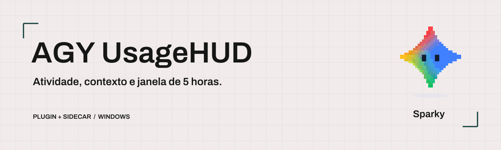
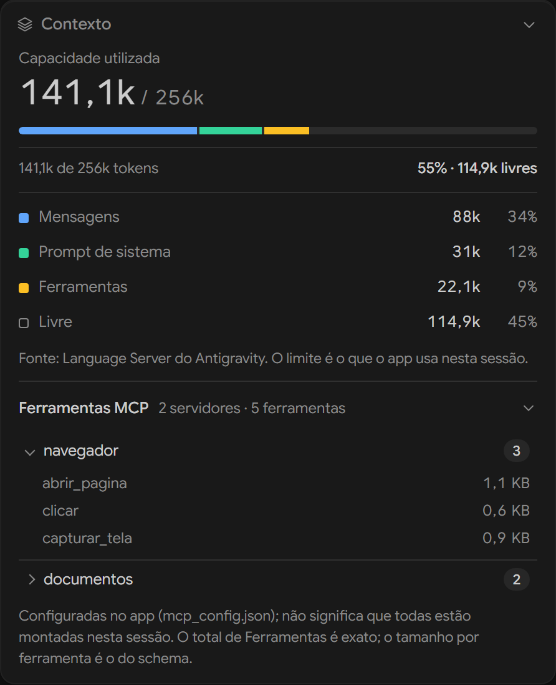

<picture>
  <source media="(prefers-color-scheme: dark)" srcset="assets/capa-sparky-dark.png">
  
</picture>

<h1 align="center">AGY UsageHUD</h1>

<p align="center">Plugin independente para o Antigravity, com um painel lateral de atividade da sessão, subagentes, contexto real e cota do modelo. Usa um <strong>sidecar local</strong> para coletar os dados e servir a interface.</p>

<p align="center">
  
  
  <a href="LICENSE"></a>
</p>

<p align="center">
  <a href="#começar-a-usar">Começar a usar</a> &nbsp; / &nbsp;
  <a href="#demonstração-e-recursos">Ver recursos</a> &nbsp; / &nbsp;
  <a href="#documentação-e-ajuda">Documentação</a>
</p>

---

## Sobre o projeto

O HUD mantém os sinais da sessão visíveis enquanto você trabalha no Antigravity. **Sparky**, o mascote de estrelinha com olhos, acompanha atividades como leitura de arquivos, pesquisa, edição e uso do terminal.

O plugin reúne manifesto, hooks, uma skill de handoff e um sidecar. O Antigravity gerencia o processo do sidecar; ele executa um servidor HTTP em loopback e fornece a página do painel. É uma integração local com o aplicativo, sem publicação no marketplace oficial.

Interface em português do Brasil. A versão atual foi validada localmente no Windows em 01/11/2026. A integração pode precisar de ajustes quando o Antigravity mudar seus formatos ou interfaces.

## Demonstração e recursos

<p align="center"></p>

Captura da interface com dados fictícios, no tema Legacy Dark. Não representa uma sessão nem uma cota real.

- Atividade da sessão com mascote e reações às ferramentas.
- Título da sessão igual ao da lista lateral do Antigravity, com modelo e projeto.
- Contexto e limite efetivo lidos do Language Server, com detalhamento por grupo e barra colorida.
- Ferramentas MCP configuradas, agrupadas por servidor, com o tamanho do schema.
- Acompanhamento dos subagentes com o nome da aba Overview, tarefa, atividade e o contexto de cada um.
- Parar um subagente em execução pelo painel, com confirmação em dois cliques, como o botão "Stop Subagent" da aba Overview.
- Cota do modelo com percentual só quando o host informa; caso contrário, só o horário de renovação.
- Cores, borda e raio do tema ativo do Antigravity: o painel muda de tema junto com o app, sem seletor próprio.
- Atualização automática a cada 5 segundos, sem botão de recarregar.

A disponibilidade dos dados depende do Antigravity. O título e a árvore de subagentes vêm do `conversation_summaries.db` do app; o nome de cada subagente é o `Role` do `invoke_subagent`; o contexto vem do `transcript.jsonl` da conversa. O total do contexto, o limite efetivo e os grupos de tokens vêm do `contextWindowUsage` do Language Server. No teste de 2026-11-14, o Gemini 4 Hydrogen apareceu com **256k de limite efetivo** e 141,1k usados (55%), não 1M. Sem resposta do Language Server, o painel mostra só os tokens e não inventa limite. A cota usa a informação do host quando acessível e nunca cai para a cota de outro modelo. A parada usa o RPC `CancelCascadeInvocation` do Language Server, o mesmo caminho da aba Overview. Não substitui a informação oficial de uso da conta.

### Detalhes do contexto

O cartão Contexto abre um detalhamento com a barra empilhada e os grupos que o Antigravity expõe: **Mensagens**, **Prompt de sistema** e **Ferramentas**, mais o **Livre**. O botão **Ferramentas MCP** abre os servidores configurados no `mcp_config.json` (não necessariamente os montados nesta sessão) e as ferramentas de cada um. O host informa o total de Ferramentas, mas não separa tokens por ferramenta; o tamanho do schema de cada uma aparece em KB.

<figure>
  
  <figcaption><sub>Mesmos dados de demonstração; o detalhamento abre no cartão Contexto e as ferramentas MCP abrem em um segundo nível.</sub></figcaption>
</figure>

### Tema nativo

O painel lê as variáveis que o Antigravity envia ao sidecar no evento `theme-change` (`--background`, `--foreground`, `--card`, `--card-border`, `--border`, `--primary`, `--secondary`, `--muted-foreground`, `--chart-1` a `--chart-6`, entre outras) e acompanha a troca de tema do app. Fora do host, ou se faltar alguma variável, valem os valores do Legacy Dark e do Default Light, extraídos do renderer do app em 14/11/2026:

| Token | Legacy Dark | Default Light | Uso no painel |
| --- | --- | --- | --- |
| `--background` | `#101010` | `#FFFFFF` | Fundo |
| `--card` | `#191919` | `#FFFFFF` | Cartões |
| `--card-border` | `#222222` | `rgb(10 10 12 / 0.12)` | Borda dos cartões |
| `--foreground` | `#CCCCCC` | `#0A0A0C` | Texto |
| `--muted-foreground` | `#6E6E6E` | `#52525B` | Texto secundário, misturado com 30% do foreground para ficar acima de 4,5:1 no escuro |
| `--primary` | `#007ACC` | `#2560A3` | Anel da cota e ponto do título |
| `--chart-1` | `#60A5FA` | `#1D4ED8` | Mensagens e acessórios do Sparky |
| `--chart-2` | `#FBBF24` | `#B45309` | Ferramentas |
| `--chart-3` | `#34D399` | `#15803D` | Prompt de sistema |

Os cartões têm raio de 12 px e borda de 1 px; botões usam 8 px e os contadores são pílulas. A fonte é a Google Sans Flex, embutida no HTML, com base de 16 px. O anel da cota troca o `--primary` pelo `--warning` a partir de 80% e pelo `--error` a partir de 95%.

A prévia [`propostas/nativo-2026-11-15/index.html`](propostas/nativo-2026-11-15/index.html) abre direto no navegador, sem servidor. Ela mostra o painel em 472 px com dados fictícios, as 19 reações do Sparky e um seletor claro/escuro que existe só na prévia.

O painel não abre sozinho ao iniciar o app: o `sidecar.json` não tem campo de auto-open e o Antigravity abre o Overview nativo por padrão. O HUD abre pela linha **Extensions** ou pela aba do painel lateral; se a aba estava aberta ao fechar, o app pode restaurá-la, mas não há garantia documentada.

### Conheça o Sparky

Sparky é a estrelinha colorida com olhos de bloco que acompanha a sessão. As expressões, os acessórios e os movimentos ajudam a reconhecer a atividade sem precisar ler cada chamada de ferramenta.

<p align="center"></p>

As 19 reações, uma por estado do `activity-engine`, capturadas da prévia. Lá elas estão animadas e, ao clicar numa delas, o painel faz a transição para aquele estado. Concluído, Interrompido, Erro e Turno encerrado são transitórios: duram cerca de 6 s e assentam em À disposição (ou em Aguardando, se o `Stop` vier com `fullyIdle:false`).

| Reação | Quando aparece | O que muda no Sparky |
| --- | --- | --- |
| À disposição | Aguardando a próxima mensagem | Olhos abertos, piscadas, flutuação suave e, de vez em quando, um olhar para os lados. |
| Pensando | O modelo prepara a próxima resposta | O corpo sobe e inclina, os olhos semicerrados olham para cima e aparece um balão com três pontos. |
| Pesquisa na web | Chamada de `search_web` | Inclina na direção de um globo que gira, com o olhar percorrendo o ambiente. |
| Usando o navegador | Chamada de `webview_browser` | Janela de navegador com um cursor que vai até o link e clica. |
| Lendo uma página | Chamada de `read_url_content` | Óculos, olhos menores e uma janela de navegador com uma faixa que desce pelas linhas. |
| Lendo um arquivo | Chamada de `read_file` ou `view_file` | Óculos, olhar que acompanha as linhas e uma lupa passando pela folha. |
| Buscando no projeto | Busca ou listagem de arquivos | Um olho mais fechado, olhar inquieto e lupa sobre uma pasta. |
| Editando arquivo | Escrita ou alteração de um arquivo | Olhos estreitos, corpo inclinado, linhas que vão sendo escritas e lápis em movimento. |
| Comando no terminal | Execução de comando ou gestão de tarefa | Flutuação mais rápida, olhar concentrado e um terminal com texto sendo digitado e cursor piscando. |
| Coordenando subagentes | Ferramentas de subagentes ou subagentes ativos | Corpo erguido e dois mini Sparkys flutuando, ligados por linhas tracejadas. A lista mostra os agentes detectados. |
| Pergunta para você | Pergunta ou pedido de permissão | Cabeça inclinada, olhos assimétricos e um balão com interrogação que pulsa. |
| Gerando imagem | Chamada de `generate_image` | Olhos bem abertos, uma moldura com paisagem e um brilho que pisca. |
| Usando ferramenta | Ferramenta sem reação própria | Duas engrenagens girando em sentidos opostos. |
| Timer em segundo plano | Chamada de `schedule` | Corpo baixo, flutuação lenta e um cronômetro com o ponteiro girando. |
| Aguardando próxima ação | Uma chamada retornou e a sessão aguarda o próximo passo | Corpo mais baixo, flutuação lenta e uma ampulheta que vira. |
| Turno encerrado | `Stop` com fim não normal (`MAX_INVOCATIONS`, `MAX_FORCED_INVOCATIONS`, `TERMINAL_STEP_TYPE`, `TERMINAL_CUSTOM_HOOK` ou sem motivo) | Olhos fechados, corpo em repouso e um "z" subindo. Não confirma que a tarefa deu certo. |
| Concluído | `Stop` com `NO_TOOL_CALL` e linhas de subagentes que terminaram | Três pulinhos, olhos felizes (^ ^) e faíscas piscando. |
| Interrompido | `Stop` com `USER_CANCELED` e subagente parado pelo painel ou pelo app | Treme de raiva, sobrancelhas franzidas, olhos apertados, uma gota escorrendo e um suspiro. |
| Erro na ferramenta | `PostToolUse` com `error` preenchido (cerca de 4 s) ou `Stop` com `ERROR` | Treme três vezes e assenta, com olhos desiguais e um triângulo de alerta piscando. |

O movimento de base combina flutuação em ciclos de 4 segundos, oito quadros de variação de cores em 8 segundos e piscadas em ciclos de 6,5 segundos. Na troca de estado o SVG continua o mesmo: pose, olhar e acessório mudam com uma transição curta, sem o mascote sumir e reaparecer. A sombra acompanha a flutuação. Esses movimentos não representam percentual de cota nem comprovam, por si só, uma tarefa em execução.

Tecnicamente, o Sparky é um sprite PNG de 32×32 ampliado com `image-rendering: pixelated`. As oito variações de cor são geradas no canvas a partir do mesmo sprite; olhos, óculos e acessórios são SVG sobrepostos. O movimento vem de keyframes CSS, não de quadros animados.

Não há botão de pausa. Com a preferência de sistema **movimento reduzido**, todas as animações e transições do Sparky param. Os estados dependem dos eventos e metadados que o Antigravity disponibiliza.

## Começar a usar

Você precisa do Antigravity App no Windows e de Node.js 22 ou superior no `PATH`. O teste local usou Node.js 22.21.1. O runtime usa módulos nativos do Node e o SDK fornecido pelo Antigravity, sem `npm install` ou chave de API de IA adicional.

Clone o projeto ou baixe o pacote da [release](https://github.com/ba-lison/agy-usage-hud/releases/latest):

```powershell
git clone https://github.com/ba-lison/agy-usage-hud.git
cd agy-usage-hud
.\sync.bat
```

O script copia o plugin para `%USERPROFILE%\.gemini\config\plugins\usage-hud`. Se já houver uma instalação, preserve uma cópia antes de executar: o script sobrescreve os arquivos de destino.

No Antigravity, confira o plugin em **Customizations > Installed** e abra o painel **AGY - UsageHUD**. Se o sidecar não aparecer, consulte a configuração de ativação na [documentação oficial de sidecars](https://antigravity.google/docs/sidecars); não substitua seu arquivo de configuração inteiro.

O painel não abre sozinho ao iniciar o app: o `sidecar.json` não tem campo de auto-open e o Antigravity abre o Overview nativo por padrão. Para abrir em um clique a partir de um chat ou artefato, use [Abrir o UsageHUD](sidecar://usage-hud/usage_hud/ui.html); o link exige o plugin habilitado e o sidecar rodando. A aba também aparece na linha **Extensions** do Overview.

Depois de atualizar apenas a interface, feche e reabra a aba do HUD. Se o aplicativo mantiver a página antiga, reinicie o Antigravity quando ele estiver ocioso. O painel consulta os dados sozinho a cada 5 segundos; não há botão de recarregar. O [guia de atualização](INTEGRACAO-V7.md#carregar-atualizacao) explica os limites desse procedimento.

### Desenvolver e verificar

```powershell
node test/metrics.test.mjs
node test/integration.test.mjs
node test/ui.test.cjs
```

A suíte de integração usa apenas Node.js. A suíte visual precisa de Playwright, Chrome e de uma instalação do Antigravity com seu `sidecar_sdk/preload.js`. Ela aceita o caminho de um pacote Playwright já instalado como primeiro argumento e o caminho do preload como segundo; veja o cabeçalho do teste.

Os testes ficam no repositório fonte; o ZIP da release contém apenas o plugin e sua documentação.

O histórico de desenvolvimento está preservado desde 30/10/2026. A proposta atual fica em `propostas/nativo-2026-11-15/`; a interface executada pelo plugin é `sidecars/usage_hud/ui.html`.

## Documentação e ajuda

| Assunto | Referência |
| --- | --- |
| Instalação, atualização, integração e limites | [INTEGRACAO-V7.md](INTEGRACAO-V7.md) |
| Manifesto do plugin | [plugin.json](plugin.json) |
| Eventos e hooks | [hooks.json](hooks.json) |
| Configuração do sidecar | [sidecar.json](sidecars/usage_hud/sidecar.json) |
| Prévia interativa com dados de demonstração | [Arquivos da demonstração](https://github.com/ba-lison/agy-usage-hud/tree/main/propostas/nativo-2026-11-15) — abra o index.html localmente |
| Bugs e sugestões | [Issues](https://github.com/ba-lison/agy-usage-hud/issues) |

Contribuições por issue ou pull request são bem-vindas. Ao relatar um problema, informe a versão do Antigravity, a versão do Node, o sistema e os passos para reproduzir. Remova dados pessoais e credenciais das capturas e dos logs compartilhados.

### Créditos e materiais de terceiros

Google Sans Flex mantém sua licença OFL. O símbolo Gemini e os nomes de produtos mantêm os direitos de seus titulares; não são relicenciados sob MIT. Este projeto não tem afiliação, patrocínio ou endosso do Google. Os detalhes e avisos estão em [THIRD_PARTY_NOTICES.md](THIRD_PARTY_NOTICES.md).

## Autoria e licença

Desenvolvido por [Alison Cruz](https://github.com/ba-lison) · **BALISON**.

Distribuído sob a [licença MIT](LICENSE).

---

<p align="center">
  <picture>
    <source media="(prefers-color-scheme: dark)" srcset="assets/assinatura-alison-balison-dark.svg">
    
  </picture>
  <br>
  <sub>Tecnologia com traço humano.</sub>
</p>
