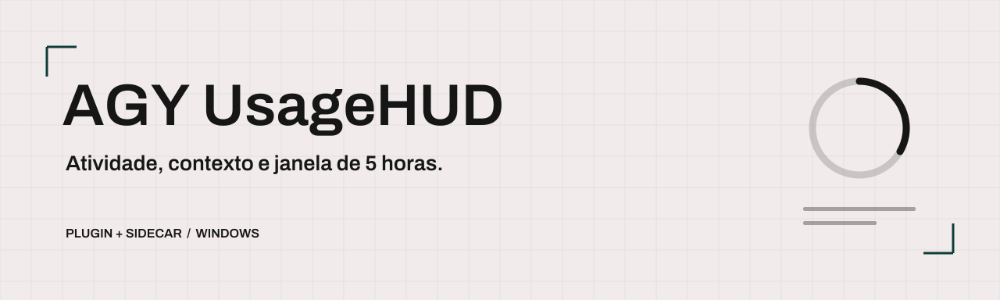
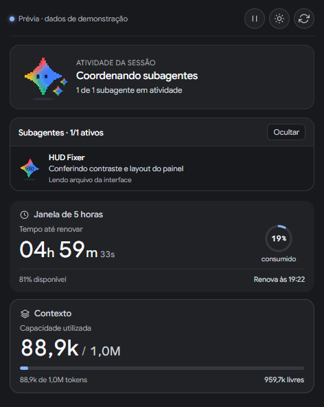
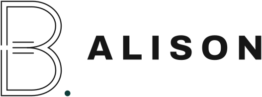

<picture>
  <source media="(prefers-color-scheme: dark)" srcset="assets/capa-dark.png">
  
</picture>

# AGY UsageHUD

Plugin independente para o Antigravity, com um painel lateral de atividade da sessão, subagentes, capacidade de contexto e janela de uso de 5 horas. Usa um **sidecar local** para coletar os dados e servir a interface.


[](LICENSE)

[Começar a usar](#começar-a-usar) · [Ver recursos](#demonstração-e-recursos) · [Documentação](#documentação-e-ajuda)

## Sobre o projeto

O HUD mantém os sinais da sessão visíveis enquanto você trabalha no Antigravity. O mascote acompanha atividades como leitura de arquivos, pesquisa, edição e uso do terminal.

O plugin reúne manifesto, hooks, uma skill de handoff e um sidecar. O Antigravity gerencia o processo do sidecar; ele executa um servidor HTTP em loopback e fornece a página do painel. É uma integração local com o aplicativo, sem publicação no marketplace oficial.

Interface em português do Brasil. A versão atual foi validada localmente no Windows em 01/11/2026. A integração pode precisar de ajustes quando o Antigravity mudar seus formatos ou interfaces.

## Demonstração e recursos

<p align="center"></p>

Captura da interface do runtime renderizada com dados de demonstração. Os testes visuais utilizam o preload real do Antigravity; a imagem não representa uma sessão ou uma cota real.

- Atividade da sessão com mascote e reações às ferramentas.
- Acompanhamento dos subagentes com Ocultar/Mostrar, sem controles de interrupção ou cópia.
- Capacidade de contexto, consumo e tempo restante da janela de 5 horas.
- Temas claro e escuro, pausa das animações e respeito a movimento reduzido.

A disponibilidade dos dados depende do Antigravity. A cota usa a informação do host quando acessível; o fallback da janela de 5 horas é uma estimativa baseada nos dados locais. Não substitui a informação oficial de uso da conta.

## Começar a usar

Você precisa do Antigravity App no Windows e de Node.js 22 ou superior no `PATH`. O teste local usou Node.js 22.21.1. O runtime usa módulos nativos do Node e o SDK fornecido pelo Antigravity, sem `npm install` ou chave de API de IA adicional.

Clone o projeto ou baixe o pacote da [release](https://github.com/ba-lison/agy-usage-hud/releases/latest):

```powershell
git clone https://github.com/ba-lison/agy-usage-hud.git
cd agy-usage-hud
.\sync.bat
```

O script copia o plugin para `%USERPROFILE%\.gemini\config\plugins\usage-hud`. Se já houver uma instalação, preserve uma cópia antes de executar: o script sobrescreve os arquivos de destino.

No Antigravity, confira o plugin em **Customizations > Installed** e abra o painel **AGY - UsageHUD**. Se o sidecar não aparecer, consulte a configuração de ativação na [documentação oficial de sidecars](https://antigravity.google/docs/sidecars); não substitua seu arquivo de configuração inteiro.

Depois de atualizar apenas a interface, feche e reabra a aba do HUD. Se o aplicativo mantiver a página antiga, reinicie o Antigravity quando ele estiver ocioso. O botão circular do painel atualiza os dados, sem reinstalar ou recarregar a interface. O [guia de atualização](INTEGRACAO-V7.md#carregar-atualizacao) explica os limites desse procedimento.

### Desenvolver e verificar

```powershell
node test/integration.test.mjs
node test/ui.test.cjs
```

A suíte de integração usa apenas Node.js. A suíte visual precisa de Playwright, Chrome e de uma instalação do Antigravity com seu `sidecar_sdk/preload.js`. Ela aceita o caminho de um pacote Playwright já instalado como primeiro argumento e o caminho do preload como segundo; veja o cabeçalho do teste.

Os testes ficam no repositório fonte; o ZIP da release contém apenas o plugin e sua documentação.

O histórico de desenvolvimento está preservado desde 30/10/2026. As propostas antigas ficam em `propostas/`; a interface executada pelo plugin é `sidecars/usage_hud/ui.html`.

## Documentação e ajuda

| Assunto | Referência |
| --- | --- |
| Instalação, atualização, integração e limites | [INTEGRACAO-V7.md](INTEGRACAO-V7.md) |
| Manifesto do plugin | [plugin.json](plugin.json) |
| Eventos e hooks | [hooks.json](hooks.json) |
| Configuração do sidecar | [sidecar.json](sidecars/usage_hud/sidecar.json) |
| Prévia interativa com dados de demonstração | [Arquivos da demonstração](https://github.com/ba-lison/agy-usage-hud/tree/main/propostas/correcao-runtime-2026-11-01) — abra o index.html localmente |
| Bugs e sugestões | [Issues](https://github.com/ba-lison/agy-usage-hud/issues) |

Contribuições por issue ou pull request são bem-vindas. Ao relatar um problema, informe a versão do Antigravity, a versão do Node, o sistema e os passos para reproduzir. Remova dados pessoais e credenciais das capturas e dos logs compartilhados.

### Créditos e materiais de terceiros

Google Sans Flex mantém sua licença OFL. O símbolo Gemini e os nomes de produtos mantêm os direitos de seus titulares; não são relicenciados sob MIT. Este projeto não tem afiliação, patrocínio ou endosso do Google. Os detalhes e avisos estão em [THIRD_PARTY_NOTICES.md](THIRD_PARTY_NOTICES.md).

## Autoria e licença

Criado por Alison Cruz / **BALISON**.

Distribuído sob a [licença MIT](LICENSE), com os avisos de materiais de terceiros indicados acima.

<picture>
  <source media="(prefers-color-scheme: dark)" srcset="assets/balison-dark.svg">
  
</picture>
