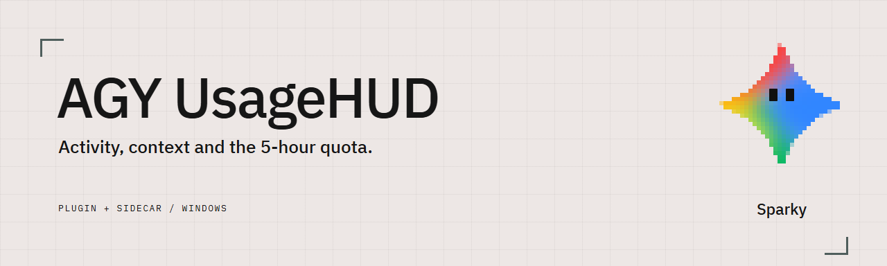
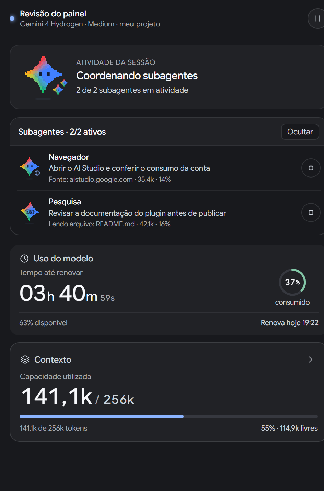
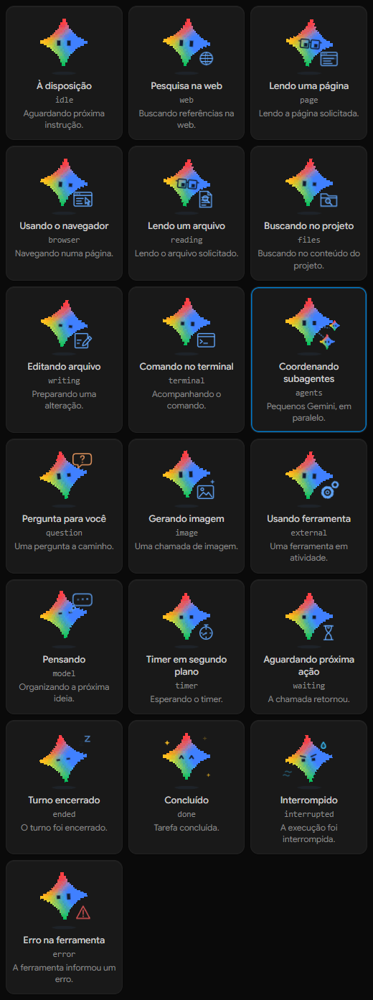

<picture>
  <source media="(prefers-color-scheme: dark)" srcset="assets/capa-sparky-en-dark.png">
  
</picture>

<h1 align="center">AGY UsageHUD</h1>

<p align="center">Know how much context and quota you have left in Antigravity. An independent plugin with a side panel for token usage, the real context window, subagents and session activity, served by a <strong>local sidecar</strong>.</p>

<p align="center">
  
  
  <a href="LICENSE"></a>
</p>

<p align="center">
  <a href="#getting-started">Get started</a> &nbsp; / &nbsp;
  <a href="#demo-and-features">See features</a> &nbsp; / &nbsp;
  <a href="#documentation-and-help">Documentation</a> &nbsp; · &nbsp;
  <a href="README.pt-BR.md">Português</a>
</p>

---

## About the project

Antigravity does not show, while you work, how much of the context window you have already used or how much is left. You find out the limit when you hit it. UsageHUD puts that information beside the session and refreshes it every 5 seconds.

The panel reads `contextWindowUsage` from the app's own Language Server and shows the total used, the session's effective limit, the token groups (messages, system prompt and tools), the model quota and the running subagents, each with its own context. **Sparky**, a star mascot with eyes, follows activities such as reading files, searching, editing and using the terminal.

The plugin bundles a manifest, hooks, a handoff skill and a sidecar. Antigravity manages the sidecar process; it runs an HTTP server on loopback and serves the panel page. It is a local integration with the app, with no publication in the official marketplace.

The interface is in Brazilian Portuguese; this README is the English version. Version 1.3.3 was validated locally on Windows on 2026-11-14, with the panel opening empty after an app restart. The integration may need adjustments when Antigravity changes its formats or interfaces.

## Demo and features

<p align="center"></p>

Screenshot of the interface with fictional data, in the Legacy Dark theme. It does not represent a real session or quota.

- Session activity with a mascot and reactions to tools.
- Session title identical to the Antigravity sidebar, with model and project.
- Context and the effective limit read from the Language Server, with a per-group breakdown and a colored bar.
- Configured MCP tools, grouped by server, with each schema size.
- Subagent tracking with the Overview tab name, task, activity and each one's context.
- Stop a running subagent from the panel, with two-click confirmation, like the "Stop Subagent" button in the Overview tab.
- Model quota with a percentage only when the host provides one; otherwise, only the renewal time.
- Colors, border and radius from the active Antigravity theme: the panel switches themes with the app and has no selector of its own.
- Automatic refresh every 5 seconds, with no reload button.
- Empty panel after restarting the app: yesterday's conversation does not appear before the first message of this run.

The HUD runs in the **Antigravity App** on Windows. Sidecars only exist in the app, so the panel does not work in the IDE or the CLI; those surfaces have other data sources and are not covered by this version.

Data availability depends on Antigravity. The title and the subagent tree come from the app's `conversation_summaries.db`; each subagent name is the `Role` of the `invoke_subagent` call; the context comes from the conversation's `transcript.jsonl`. The context total, the effective limit and the token groups come from the Language Server's `contextWindowUsage`. In the 2026-11-14 test, Gemini 4 Hydrogen showed **an effective limit of 256k** with 141.1k used (55%), not 1M. Without a Language Server response, the panel shows only the tokens and invents no limit. The quota uses the host information when available and never falls back to another model's quota. Stop uses the Language Server's `CancelCascadeInvocation` RPC, the same path as the Overview tab. It does not replace the official account usage information.

### Context details

The Context card opens a breakdown with the stacked bar and the groups Antigravity exposes: **Messages**, **System prompt** and **Tools**, plus **Free**. The **MCP tools** button opens the servers configured in `mcp_config.json` (not necessarily the ones mounted in this session) and each one's tools. The host reports the Tools total but does not split tokens per tool; each schema size appears in KB.

<figure>
  
  <figcaption><sub>Same demo data; the breakdown opens on the Context card and the MCP tools open on a second level.</sub></figcaption>
</figure>

### Native theme

The panel reads the variables Antigravity sends to the sidecar in the `theme-change` event (`--background`, `--foreground`, `--card`, `--card-border`, `--border`, `--primary`, `--secondary`, `--muted-foreground`, `--chart-1` to `--chart-6`, among others) and follows the app's theme changes. Outside the host, or when a variable is missing, the Legacy Dark and Default Light values extracted from the app renderer on 2026-11-14 apply:

| Token | Legacy Dark | Default Light | Use in the panel |
| --- | --- | --- | --- |
| `--background` | `#101010` | `#FFFFFF` | Background |
| `--card` | `#191919` | `#FFFFFF` | Cards |
| `--card-border` | `#222222` | `rgb(10 10 12 / 0.12)` | Card border |
| `--foreground` | `#CCCCCC` | `#0A0A0C` | Text |
| `--muted-foreground` | `#6E6E6E` | `#52525B` | Secondary text, mixed with 30% of the foreground to stay above 4.5:1 in dark mode |
| `--primary` | `#007ACC` | `#2560A3` | Quota ring and title dot |
| `--chart-1` | `#60A5FA` | `#1D4ED8` | Messages and Sparky accessories |
| `--chart-2` | `#FBBF24` | `#B45309` | Tools |
| `--chart-3` | `#34D399` | `#15803D` | System prompt |

Cards have a 12 px radius and a 1 px border; buttons use 8 px and counters are pills. The typeface is Google Sans Flex, embedded in the HTML, with a 16 px base. The quota ring switches `--primary` to `--warning` from 80% and to `--error` from 95%.

The [`preview/index.html`](preview/index.html) preview opens directly in the browser, with no server. It shows the 472 px panel with fictional data, the 19 Sparky reactions and a light/dark selector that exists only in the preview.

The panel does not open by itself when the app starts: `sidecar.json` has no auto-open field and Antigravity opens the native Overview by default. The HUD opens from the **Extensions** row or the side panel tab; if the tab was open when you closed the app, it may be restored, but that is not documented as guaranteed.

### Meet Sparky

Sparky is the colored star with block eyes that follows the session. Expressions, accessories and movements help you recognize the activity without reading every tool call.

<p align="center"></p>

The 19 reactions, one per `activity-engine` state, captured from the preview. There they are animated, and clicking one makes the panel transition to that state. Done, Interrupted, Error and Turn ended are transient: they last about 6 s and settle into Idle (or Waiting, when the `Stop` arrives with `fullyIdle:false`).

The [`sparky/sparky.html`](sparky/sparky.html) gallery opens the same thing on its own, with no server: the 19 animated reactions, with a theme selector and the loose SVGs in `sparky/sprites/`.

| Reaction | When it appears | What changes in Sparky |
| --- | --- | --- |
| Idle | Waiting for the next message | Open eyes, blinking, a soft float and, now and then, a glance to the sides. |
| Thinking | The model prepares the next response | The body rises and tilts, half-closed eyes look up and a speech bubble with three dots appears. |
| Web search | `search_web` call | Tilts toward a spinning globe, with the gaze sweeping the environment. |
| Using the browser | `webview_browser` call | A browser window with a cursor that reaches the link and clicks. |
| Reading a page | `read_url_content` call | Glasses, smaller eyes and a browser window with a band that scrolls down the lines. |
| Reading a file | `read_file` or `view_file` call | Glasses, a gaze that follows the lines and a magnifier moving across the page. |
| Searching the project | File search or listing | One eye more closed, a restless gaze and a magnifier over a folder. |
| Editing a file | Writing or changing a file | Narrow eyes, a tilted body, lines being written and a moving pencil. |
| Terminal command | Command execution or task management | Faster floating, a focused gaze and a terminal with text being typed and a blinking cursor. |
| Coordinating subagents | Subagent tools or active subagents | An upright body and two mini Sparkys floating, linked by dashed lines. The list shows the detected agents. |
| Question for you | Question or permission request | A tilted head, asymmetric eyes and a bubble with a pulsing question mark. |
| Generating an image | `generate_image` call | Wide-open eyes, a frame with a landscape and a blinking glow. |
| Using a tool | A tool without a reaction of its own | Two gears turning in opposite directions. |
| Background timer | `schedule` call | A low body, a slow float and a stopwatch with a spinning hand. |
| Waiting for the next action | A call returned and the session awaits the next step | A lower body, a slow float and an hourglass that flips. |
| Turn ended | `Stop` with an abnormal ending (`MAX_INVOCATIONS`, `MAX_FORCED_INVOCATIONS`, `TERMINAL_STEP_TYPE`, `TERMINAL_CUSTOM_HOOK` or no reason) | Closed eyes, a resting body and a rising "z". It does not confirm that the task succeeded. |
| Done | `Stop` with `NO_TOOL_CALL` and finished subagent rows | Three hops, happy eyes (^ ^) and blinking sparks. |
| Interrupted | `Stop` with `USER_CANCELED` and a subagent stopped from the panel or the app | Shakes with anger, frowning brows, squinting eyes, a dripping drop and a sigh. |
| Tool error | `PostToolUse` with a filled `error` (about 4 s) or `Stop` with `ERROR` | Shakes three times and settles, with uneven eyes and a blinking warning triangle. |

The base movement combines a float in 4-second cycles, eight color-variation frames in 8 seconds and blinks in 6.5-second cycles. When the state changes, the SVG stays the same: pose, gaze and accessory change with a short transition, without the mascot disappearing and reappearing. The shadow follows the float. These movements do not represent a quota percentage nor do they prove, on their own, that a task is running.

Technically, Sparky is a 32×32 PNG sprite enlarged with `image-rendering: pixelated`. The eight color variations are generated on a canvas from the same sprite; eyes, glasses and accessories are overlaid SVG. The movement comes from CSS keyframes, not animated frames.

There is no pause button. With the system's **reduce motion** preference, all Sparky animations and transitions stop. States depend on the events and metadata Antigravity provides.

## Getting started

You need the Antigravity App on Windows and Node.js 22 or later on the `PATH`. The local test used Node.js 22.21.1. The runtime uses native Node modules and the SDK provided by Antigravity, with no `npm install` or extra AI API key.

Clone the project or download the package from the [latest release](https://github.com/ba-lison/agy-usage-hud/releases/latest):

```powershell
git clone https://github.com/ba-lison/agy-usage-hud.git
cd agy-usage-hud
.\sync.bat
```

The script copies the plugin to `%USERPROFILE%\.gemini\config\plugins\usage-hud`. If an installation already exists, keep a copy before running it: the script overwrites the destination files.

In Antigravity, check the plugin under **Customizations > Installed** and open the **AGY - UsageHUD** panel. If the sidecar does not appear, see the activation settings in the [official sidecar documentation](https://antigravity.google/docs/sidecars); do not replace your entire configuration file.

The panel does not open by itself when the app starts: `sidecar.json` has no auto-open field and Antigravity opens the native Overview by default. To open it with one click from a chat or artifact, use [Open UsageHUD](sidecar://usage-hud/usage_hud/ui.html); the link requires the plugin enabled and the sidecar running. The tab also appears in the **Extensions** row of the Overview.

After updating only the interface, close and reopen the HUD tab. If the app keeps the old page, restart Antigravity while it is idle. The panel fetches data on its own every 5 seconds; there is no reload button. The [update guide](docs/INTEGRACAO.md) (in Portuguese) explains the limits of that procedure.

### Develop and verify

```powershell
node test/metrics.test.mjs
node test/integration.test.mjs
node test/ui.test.cjs
```

The integration suite uses only Node.js. The visual suite needs Playwright, Chrome and an Antigravity installation with its `sidecar_sdk/preload.js`. It accepts the path of an already installed Playwright package as the first argument and the preload path as the second; see the test header.

Tests live in the source repository; the release ZIP contains only the plugin and its documentation.

The development history is preserved since 2026-10-30. The interface the plugin runs is `sidecars/usage_hud/ui.html`; the panel preview is in `preview/` and the Sparky sprites in `sparky/`.

## Documentation and help

| Subject | Reference |
| --- | --- |
| Installation, updates, integration and limits (PT-BR) | [docs/INTEGRACAO.md](docs/INTEGRACAO.md) |
| Plugin manifest | [plugin.json](plugin.json) |
| Events and hooks | [hooks.json](hooks.json) |
| Sidecar configuration | [sidecar.json](sidecars/usage_hud/sidecar.json) |
| Interactive preview with demo data | [Demo files](https://github.com/ba-lison/agy-usage-hud/tree/main/preview) — open index.html locally |
| Gallery of the 19 Sparky reactions | [sparky/sparky.html](sparky/sparky.html) |
| Bugs and suggestions | [Issues](https://github.com/ba-lison/agy-usage-hud/issues) |
| Portuguese version of this README | [README.pt-BR.md](README.pt-BR.md) |

Contributions through issues or pull requests are welcome. When reporting a problem, include the Antigravity version, the Node version, the system and the steps to reproduce. Remove personal data and credentials from shared screenshots and logs.

### Credits and third-party materials

Google Sans Flex keeps its OFL license. The Gemini symbol and product names keep their owners' rights; they are not relicensed under MIT. This project has no affiliation, sponsorship or endorsement from Google. Details and notices are in [THIRD_PARTY_NOTICES.md](THIRD_PARTY_NOTICES.md).

## Author and license

Built by [Alison Cruz](https://github.com/ba-lison) · **BALISON**.

Distributed under the [MIT license](LICENSE).

---

<p align="center">
  <picture>
    <source media="(prefers-color-scheme: dark)" srcset="assets/assinatura-alison-balison-dark.svg">
    
  </picture>
  <br>
  <sub>Technology with a human touch.</sub>
</p>
